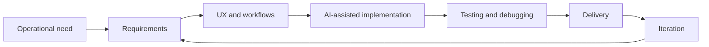

# Internal Application Development | Professional Case Study

> **Project type:** Internal business application  
> **Organization:** Eneba  
> **Role:** AI-assisted product development / end-to-end application delivery  
> **Source code:** Private; not included in this repository

## Overview

This case study documents the development process and responsibilities involved in building an internal software application in a professional environment.

My starting point was a background in Customer Service, with direct visibility into operational needs. I used that context to help shape a software solution and take responsibility for its delivery, using AI-assisted development tools throughout the process.

**This repository is documentation, not the application's source code.** It describes my contribution without exposing proprietary code, sensitive business workflows, private data, or other internal materials.

## My contributions

| Area | Work performed |
| --- | --- |
| Product discovery | Translated business and user needs into functional requirements. |
| Product planning | Defined workflows, expected behaviors, and feature scope. |
| UX/UI | Planned and iterated on the interface and user experience. |
| AI-assisted implementation | Used AI tools to support code generation and iterative changes. |
| Quality | Tested features, identified issues, and guided corrections. |
| Delivery | Participated in deployment, updates, and ongoing improvement. |

## Development workflow

## Technologies and tools

My broader development workflow includes **TypeScript, JavaScript, Python, Node.js, SQL/PostgreSQL, Docker, ChatGPT, OpenAI Codex, Claude, and Claude Code**.

> The list above describes tools used in my development practice. It is **not** a claim that every tool was used in this specific application. The exact internal stack is not published here.

## What this project demonstrates

- Taking ownership of an application from initial planning to delivery.
- Communicating product requirements clearly, including when working with AI coding tools.
- Evaluating implementation results and iterating through testing and troubleshooting.
- Bringing operational and customer-facing context into technical decision-making.
- Working with business applications where code cannot always be made public.

## Scope and confidentiality

This public case study intentionally excludes:

- Internal source code, credentials, configuration, or infrastructure details.
- Screenshots or diagrams that reveal sensitive company information.
- Customer information, ticket contents, private business metrics, or internal processes.
- Unverified performance or business-impact claims.

## Discussing the work

I can explain the high-level development approach, my responsibilities, how I used AI-assisted tools, and how I approached testing and iteration, while respecting company confidentiality.

---

**Author:** [Seth Castañeda](https://github.com/Name-less56)  
**Related profile:** [GitHub profile](https://github.com/Name-less56)
